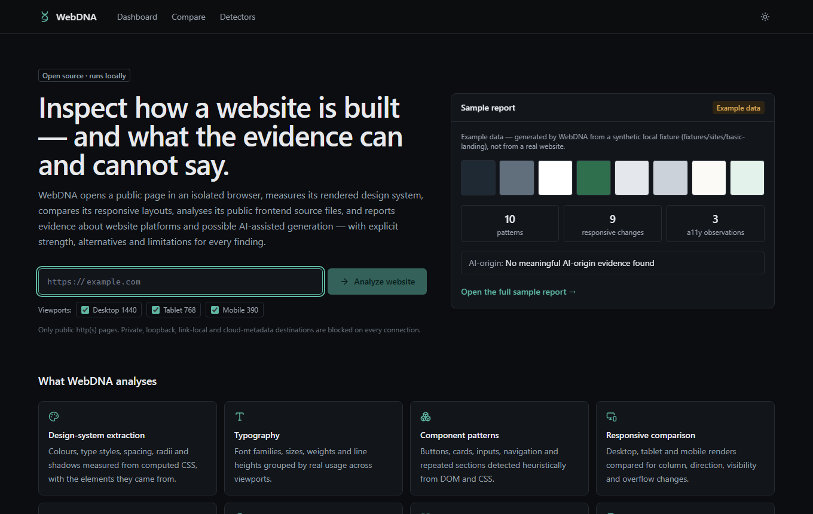
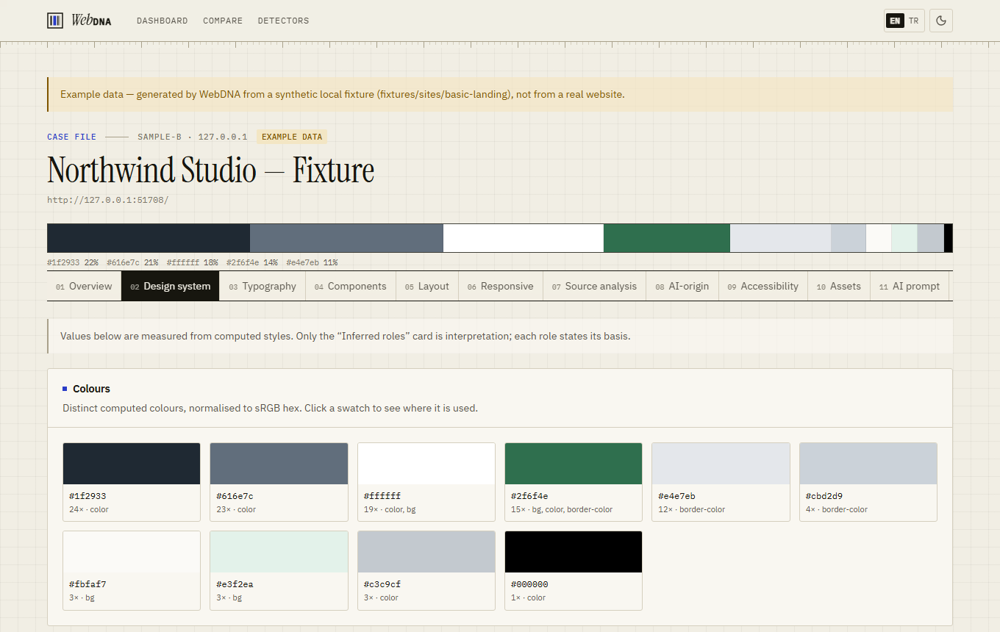
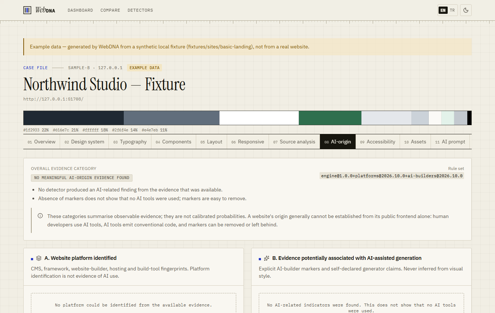
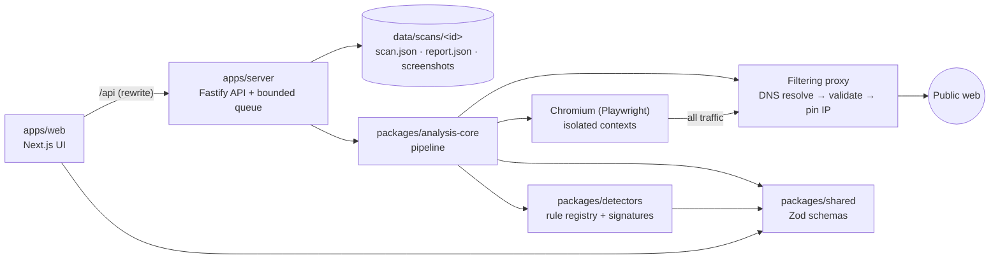

# WebDNA

**Open-source website intelligence and evidence-based AI-origin analysis.**

WebDNA opens a public web page in an isolated, network-filtered browser, measures its rendered design system, compares its desktop/tablet/mobile layouts, statically analyses the frontend files it loaded, and evaluates versioned detector rules that look for website-platform fingerprints, template reuse and explicit signs of AI-assisted website builders. Every finding carries its evidence, strength, alternative explanations and limitations.



## Why this project exists

"Was this site made with AI?" is a question people increasingly ask — and one that is usually answered with confident guesses based on how a site _looks_. WebDNA takes the opposite approach:

- It reports only what can be **observed** from a public page (DOM, computed CSS, headers, loaded HTML/CSS/JS, public source maps).
- It keeps three questions apart: **which platform** built/hosts the site, whether there is **evidence potentially associated with AI-assisted generation**, and whether there are **template/boilerplate signals**.
- It says **"insufficient evidence"** or **"no meaningful evidence"** when that is the honest answer.

The same pipeline is useful on its own for design-system extraction, responsive QA and frontend reconnaissance.

## Features

| Area                 | What you get                                                                                                                                                                                                                                                   |
| -------------------- | -------------------------------------------------------------------------------------------------------------------------------------------------------------------------------------------------------------------------------------------------------------- |
| Design system        | Colours (incl. `oklch`/`lab`/`display-p3` → sRGB), type styles, spacing scale with inferred base unit, radii, shadows, borders, declared `:root` custom properties, inferred roles with basis and confidence                                                   |
| Components           | Heuristic patterns: navigation, header/footer, buttons, links, cards, inputs/forms, dialogs, badges, repeated sections, image containers                                                                                                                       |
| Responsive           | Real 1440 / 768 / 390 px renders compared for flex-direction, grid columns, visibility, typography, navigation collapse and horizontal overflow                                                                                                                |
| Source analysis      | HTML comments/meta, CSS parsed with css-tree (rules, breakpoints, custom properties, font faces), JS parsed with acorn as data (banners, comments, module shape), same-origin source maps (paths only), class-naming conventions, source ↔ runtime correlation |
| AI-origin analysis   | Versioned rule registry (JSON signatures + code rules), five evidence categories, platform vs. AI vs. template separation, conflicts, coverage, detector versions                                                                                              |
| Accessibility        | Automated observations (lang, alt text, accessible names, labels, headings, contrast on solid backgrounds, mobile touch targets) — not a WCAG audit                                                                                                            |
| Evidence inspector   | Click any token, component or finding to see the selector, observed value and the element highlighted on the screenshot it was measured in                                                                                                                     |
| History & comparison | Diff two scans; detector-version changes are shown separately from site changes                                                                                                                                                                                |
| Exports              | JSON report, CSS variables, Tailwind CSS v4 `@theme`, Markdown, evidence ZIP (report + WebDNA screenshots)                                                                                                                                                     |
| Languages            | English and Turkish interface (EN/TR switcher; defaults to the browser language). Engine-generated explanations are English                                                                                                                                    |

| Design system                                            | AI-origin analysis                                      |
| -------------------------------------------------------- | ------------------------------------------------------- |
|  |  |

_Screenshots show the bundled sample report, generated from a synthetic local fixture — not a real website._

## AI-origin methodology and limitations

WebDNA answers three separate questions:

1. **Website platform identification** — e.g. WordPress generator tag, `/_next/static/` assets, `x-vercel-id` header, `ng-version` attribute. _A framework, CMS or host is never treated as evidence of AI._
2. **AI-assisted generation signals** — only explicit markers: a known AI builder's editor script or hosting domain, or a generator tag/source comment that names an AI tool. The link to AI is recorded as _indirect_ when it is inferred from a platform.
3. **Template and boilerplate signals** — unchanged starter content, lorem ipsum, unreplaced `{{variables}}`, default starter assets, placeholder links. _Reuse is not AI involvement._

The overall result is one of five **evidence categories** (not probabilities):

| Category                                  | When                                                    |
| ----------------------------------------- | ------------------------------------------------------- |
| Strong AI-related evidence found          | The strongest AI-related finding is strong              |
| Some AI-related indicators found          | The strongest AI-related finding is moderate            |
| Weak or ambiguous indicators found        | Only weak indicators (any number of them)               |
| No meaningful AI-origin evidence found    | Evidence was available; no AI-related finding           |
| Insufficient evidence to determine origin | Bot-challenge page, empty shell, or nothing inspectable |

Rules that matter:

- Weak signals are **never** combined into a stronger conclusion.
- Experimental (community-reported, unreproduced) signatures are **capped at weak**.
- Visual polish, generic layouts, stock or AI-generated images, repetition and popular frameworks are **not** used as evidence.
- WebDNA never identifies a model or provider (Claude, GPT, Gemini…) — it can only quote a page that explicitly names one.
- Markers can be removed, copied or left behind after heavy editing; their absence proves nothing.
- Detector behaviour has only been evaluated on **synthetic fixtures** ([results](docs/evaluation-results.md)). **No real-world accuracy is claimed.**

Details: [docs/ai-origin-methodology.md](docs/ai-origin-methodology.md).

## Architecture



| Package                  | Responsibility                                                                                                                        |
| ------------------------ | ------------------------------------------------------------------------------------------------------------------------------------- |
| `packages/shared`        | Zod schemas and types for scans, reports, findings and API contracts                                                                  |
| `packages/detectors`     | Evidence bundle, rule registry, JSON signature sets, code rules, conclusion engine                                                    |
| `packages/analysis-core` | SSRF policy, filtering proxy, safe fetcher, browser session, extraction, source analysis, responsive comparison, exports, report diff |
| `apps/server`            | HTTP API, bounded in-process job queue, file-based storage, retention                                                                 |
| `apps/web`               | Landing page, dashboard, live stage progress, report workspace, comparison, detector catalog                                          |

There is no database: each report is a self-contained JSON file. See [docs/architecture.md](docs/architecture.md) for the data flow and the scan lifecycle.

## Installation

Requirements: **Node.js ≥ 22.12** (tested with 26.13), npm ≥ 10, ~400 MB disk for Chromium. Windows, macOS and Linux are supported.

```bash
git clone https://github.com/mahmutcirka/webdna.git
cd webdna
npm install
npx playwright install chromium   # on Linux CI: npx playwright install --with-deps chromium
cp .env.example .env              # optional; defaults work for local use
npm run dev
```

Open <http://localhost:3000>. The API listens on `127.0.0.1:4100`; the web app proxies `/api` to it.

Production build:

```bash
npm run build
npm start
```

### Environment variables

| Variable                                           | Default                     | Purpose                                                                                                                                                 |
| -------------------------------------------------- | --------------------------- | ------------------------------------------------------------------------------------------------------------------------------------------------------- |
| `WEBDNA_HOST` / `WEBDNA_PORT`                      | `127.0.0.1` / `4100`        | API bind address. WebDNA has no authentication — keep it on localhost or behind an authenticating proxy                                                 |
| `WEBDNA_DATA_DIR`                                  | `./data`                    | Scan records, reports and screenshots (git-ignored)                                                                                                     |
| `WEBDNA_MAX_CONCURRENCY`                           | `2`                         | Scans running at once                                                                                                                                   |
| `WEBDNA_MAX_QUEUE`                                 | `20`                        | Waiting scans before new ones get HTTP 429                                                                                                              |
| `WEBDNA_RETENTION_DAYS`                            | `14`                        | Delete scans older than this (0 = keep)                                                                                                                 |
| `WEBDNA_NAV_TIMEOUT_MS` / `WEBDNA_SCAN_TIMEOUT_MS` | `30000` / `180000`          | Navigation and whole-scan time limits                                                                                                                   |
| `WEBDNA_MAX_TOTAL_BYTES` / `WEBDNA_MAX_REQUESTS`   | 64 MiB / `600`              | Per-scan transfer and request budgets                                                                                                                   |
| `WEBDNA_ALLOWED_PORTS`                             | `80,443,8080,8443`          | Ports the browser may connect to                                                                                                                        |
| `WEBDNA_DISABLED_DETECTORS`                        | —                           | Comma-separated detector ids to skip                                                                                                                    |
| `WEBDNA_ALLOWED_HOSTS`                             | `localhost,127.0.0.1,[::1]` | Host names accepted in `Host`/`X-Forwarded-Host`; blocks DNS-rebinding access from websites. Add your hostname if you put WebDNA behind a reverse proxy |
| `WEBDNA_OFFLINE_DNS`                               | `0`                         | Fail all DNS lookups (tests, air-gapped use)                                                                                                            |
| `WEBDNA_UNSAFE_ALLOW_LOOPBACK`                     | —                           | **Development only.** Exact `host:port` pairs on loopback that may be scanned (local fixtures)                                                          |
| `WEBDNA_API_URL`                                   | `http://127.0.0.1:4100`     | Where the web app proxies `/api` (read at build/start time)                                                                                             |

## Development and tests

| Command                                 | What it does                                                                                                                                                            |
| --------------------------------------- | ----------------------------------------------------------------------------------------------------------------------------------------------------------------------- |
| `npm run dev`                           | API (tsx watch) + web (Next.js dev)                                                                                                                                     |
| `npm run lint` / `npm run format:check` | ESLint / Prettier                                                                                                                                                       |
| `npm run typecheck`                     | Strict TypeScript for all packages and the web app                                                                                                                      |
| `npm test`                              | Unit tests: SSRF policy, URL normalisation, IPv4/IPv6 ranges, colour parsing, CSS/JS analysis, responsive diff, design extraction, detectors, API lifecycle             |
| `npm run test:detectors`                | Detector positive/negative/ambiguous/regression fixtures                                                                                                                |
| `npm run test:integration`              | Real Chromium scans of local fixture sites, exports, comparison, redirects to private/metadata addresses, timeouts, transfer limits, cancellation                       |
| `npm run test:e2e`                      | Playwright end-to-end tests of the UI (submission, progress, report, evidence inspector, exports, 375 px overflow, error states, cancellation) against offline fixtures |
| `npm run eval`                          | Confusion matrix on the synthetic evaluation set                                                                                                                        |
| `npm run sample-report`                 | Regenerate the bundled sample report from the fixture                                                                                                                   |
| `npm run verify:prod-host`              | After `npm run build`: checks the DNS-rebinding Host allow-list against `next start` and the bundled API                                                                |
| `npm run check:release`                 | Secret, artefact and claim checks before publishing                                                                                                                     |

See [docs/testing.md](docs/testing.md).

## Example workflow

1. Enter `https://example.com` on the landing page and press **Analyze website**.
2. Watch the nine real backend stages (validation → browser → load → screenshots → extraction → tokens → AI-origin → viewport comparison → report).
3. Explore the tabs; click any swatch, component or finding to open the **evidence inspector**.
4. Export the report or design tokens from the **Export** tab.
5. Scan again later and open **Compare** to see what changed — and whether a detector version changed.

## Security considerations

- Every connection the browser makes goes through a per-scan forward proxy (Chromium `--proxy-server` with `<-loopback>` so even localhost is proxied). The proxy resolves DNS once, rejects private, loopback, link-local (incl. `169.254.169.254`), CGNAT (incl. `100.100.100.200`), unique-local (incl. `fd00:ec2::254`), multicast, reserved, documentation and IPv4-embedding IPv6 ranges, then connects to the validated IP. Redirect and DNS-rebinding vectors tested against local canaries were blocked (see docs/status.md); this is tested behaviour, not a proof.
- Chromium's own host resolver is disabled for page hostnames (`--host-resolver-rules`), so pages cannot trigger DNS lookups of attacker-chosen names; verified with Chromium's net-log in `tests/integration/netlog.test.ts`.
- Measurements run in a CDP isolated world: page scripts cannot override built-ins to forge styles or stall the scan, and every in-page call is time-bounded.
- QUIC and non-proxied WebRTC are disabled; service workers, downloads and permissions are blocked; non-http(s) schemes are aborted.
- Per-scan limits: transfer bytes, connections, requests, redirects, navigation and total time, captured-source size.
- Downloaded HTML/CSS/JS is parsed as data (htmlparser2, css-tree, acorn) and never executed outside the isolated browser. Source maps are fetched only when explicitly referenced and same-origin, through the same policy; only file paths are kept.
- Snippets stored in reports are truncated and secret-looking values are redacted.
- WebDNA does not claim absolute protection against browser sandbox escapes. Run it on a machine/container you are comfortable exposing to untrusted web content.

See [SECURITY.md](SECURITY.md).

## Adding detectors

Most platform/AI-builder fingerprints are data: add an entry to `packages/detectors/signatures/*.json` with matchers (`meta`, `header`, `hostname`, `script_url`, `asset_path`, `html_comment`, `dom_selector`, `runtime_global`, `js_source`, `css_source`, `source_map_path`), provenance, limitations and — for AI-first builders — an `aiAssociation`. Add positive and negative fixtures and tests. Community-reported markers must ship as `experimental`. Full guide: [docs/detectors.md](docs/detectors.md).

## Contributing

Contributions are welcome — see [CONTRIBUTING.md](CONTRIBUTING.md) and the [Code of Conduct](CODE_OF_CONDUCT.md).

## License and attribution

WebDNA is licensed under the [Apache License 2.0](LICENSE). Third-party dependencies and their licenses are listed in [THIRD_PARTY_NOTICES.md](THIRD_PARTY_NOTICES.md). The repository bundles no third-party fonts, images or website content; screenshots of sites you scan stay in your local `data/` directory and may be subject to those sites' terms.
