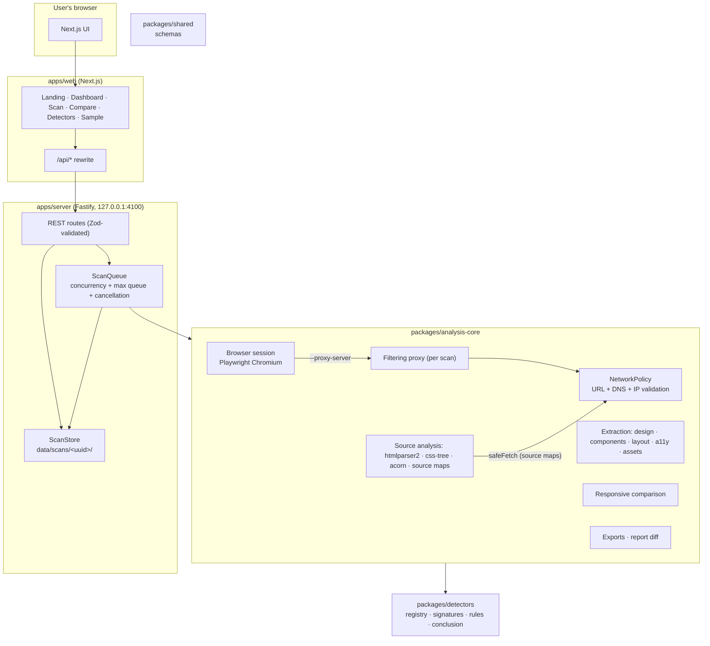
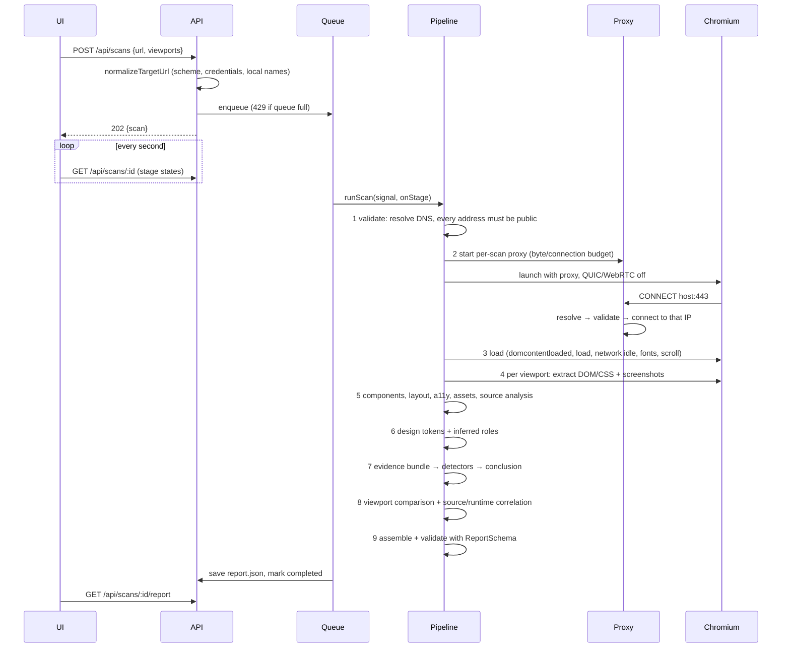

# Architecture

WebDNA is an npm-workspaces monorepo with two apps and three packages. It deliberately avoids infrastructure it does not need: there is no database, Redis or message broker. A scan is one job in a bounded in-process queue; its state and report are JSON files.

## Components

## Scan lifecycle

Failure states use stable error codes (`invalid_url`, `blocked_destination`, `dns_failure`, `navigation_failed`, `navigation_timeout`, `resource_limit`, `scan_timeout`, `cancelled`, `interrupted`, `internal_error`). A failed scan never produces a report. Scans left running when the server stops are marked `interrupted` at the next start.

## Data model

- **ScanRecord** (`scan.json`): id, URLs, status, per-stage state/message/timestamps, warnings, error, summary.
- **Report** (`report.json`, schema version `1.0.0`): target, metadata, per-viewport observations, design system, layout, components, responsive changes, accessibility, assets, source analysis, AI-origin report, warnings, applied limits.
- **Finding**: detector id/version, optional signature id/version, category (`platform` | `ai_origin_signal` | `template_signal`), subject, strength, direct/indirect, explanation, evidence references, alternative explanations, limitations, experimental flag.

All contracts live in `packages/shared` as Zod schemas; the server validates every report before saving it.

## Measured vs. inferred

| Measured (observed directly)                     | Inferred (heuristic, labelled as such)                               |
| ------------------------------------------------ | -------------------------------------------------------------------- |
| Computed colours, fonts, spacing, radii, shadows | Colour/font roles ("primary text", "accent") with basis + confidence |
| Element rectangles, display/flex/grid values     | Component patterns (button, card, badge…)                            |
| Media queries, custom properties in CSS          | Spacing base unit                                                    |
| Generator tags, headers, asset paths, comments   | Platform identity; AI association; template reuse                    |

## Why no database / Redis

A single WebDNA instance runs at most a handful of browser scans in parallel. Reports are immutable documents that are always read whole, and listing a few hundred directories is cheap. If you need multi-instance deployment, the `ScanQueue` and `ScanStore` interfaces are the seams to replace with BullMQ/PostgreSQL.
